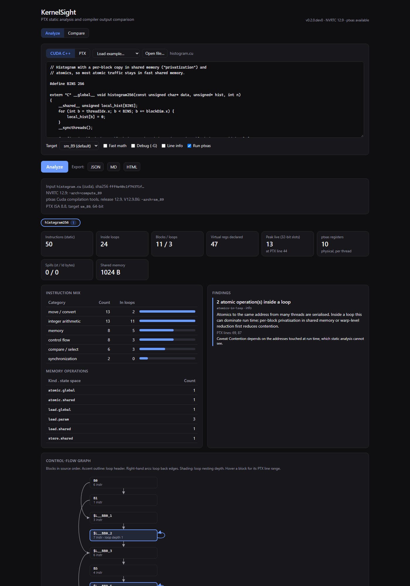
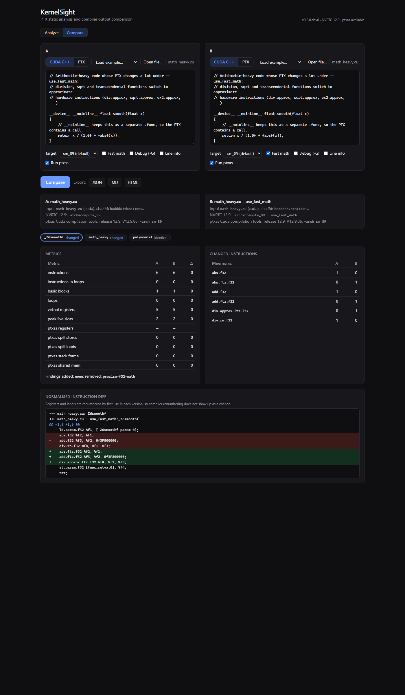

# KernelSight

**PTX static analysis and compiler output comparison for CUDA kernels.**

KernelSight parses the PTX that the CUDA compiler emits, analyses its
structure (instruction mix, control flow, loops, register liveness), pulls in
the real register and spill numbers from NVIDIA's `ptxas` assembler, and
compares two compilations of the same code to show what a compiler option or
target change actually did. Results come as reproducible JSON, Markdown or
HTML reports, from a CLI or a small web UI.

The core needs only Python and works on PTX text without a GPU. Compiling
`.cu` files and reading `ptxas` resource usage use NVIDIA's NVRTC and `ptxas`,
installed as pip wheels (no CUDA Toolkit or host C++ compiler needed).



## What it shows

Real output from the example kernels in [`examples/kernels`](examples/kernels)
(CUDA 12.9, sm_89). Full reports: [`examples/reports`](examples/reports).

**`--use_fast_math` on [`math_heavy.cu`](examples/kernels/math_heavy.cu)**
([report](examples/reports/compare-math-heavy-fast-math.md)):
`div.rn.f32` becomes `div.approx.ftz.f32`; the `math_heavy` kernel drops from
199 to 31 PTX instructions and 18 to 3 basic blocks, ptxas registers from 22
to 14, and the precise-math and local-memory findings disappear. The FP64
`polynomial` kernel is unchanged.

**sm_75 vs sm_89 for [`matmul.cu`](examples/kernels/matmul.cu)**
([report](examples/reports/compare-matmul-sm75-vs-sm89.md)): NVRTC emits
*identical* PTX for both targets, yet ptxas allocates 49 vs 40 registers for
`matmul_naive`. PTX is a virtual ISA; architecture-specific work happens in
`ptxas`.

**Declared vs live vs allocated registers**
([report](examples/reports/analyze-register-pressure-maxrreg24.md)):

| Kernel | Virtual registers declared in PTX | Peak live (32-bit slots, PTX liveness) | ptxas registers |
|---|---|---|---|
| `many_live_values` | 303 | 69 | 40 (24 with `-maxrregcount=24`: 416 B spilled) |
| `matmul_tiled` | 133 | 26 | 38 |
| `vector_add` | 23 | 10 | 12 |

PTX registers are unlimited virtual registers, so their declared count says
little; liveness is an explainable estimate; ptxas is the ground truth.

**`-G` (debug) on [`elementwise.cu`](examples/kernels/elementwise.cu)**
([report](examples/reports/compare-elementwise-debug.md)): no `fma`
contraction, `ld.global` becomes a generic `ld`, `make_float4` becomes a real
call, and `scale_vec4` goes from 14 to 28 registers with a 16-byte stack frame.



## Quick start

Python 3.11+ (tested on 3.13), Windows or Linux.

```powershell
git clone https://github.com/ManishPingale7/KernelSight.git
cd KernelSight
py -3.13 -m venv .venv; .venv\Scripts\Activate.ps1     # Linux: python3 -m venv .venv && . .venv/bin/activate
pip install -e ".[dev,toolchain,api]"   # toolchain: NVRTC + ptxas wheels; api: web UI
kernelsight doctor                      # shows which NVIDIA tools were found
pytest                                  # toolchain tests skip if the tools are missing
```

### CLI

```powershell
# analyse PTX, or CUDA C++ compiled with NVRTC (ptxas runs automatically if installed)
kernelsight analyze examples/kernels/matmul.cu
kernelsight analyze kernel.ptx --format html -o report.html
kernelsight analyze examples/kernels/register_pressure.cu --ptxas-opt=-maxrregcount=24

# compare two files, or one .cu file under two option sets
kernelsight compare a.ptx b.ptx
kernelsight compare examples/kernels/math_heavy.cu --b-opt=--use_fast_math
kernelsight compare examples/kernels/matmul.cu --a-arch=sm_75 --b-arch=sm_89 --format json

# control-flow graph as Graphviz DOT
kernelsight cfg examples/kernels/matmul.cu -f matmul_tiled > cfg.dot
```

Options that start with `-` are attached with `=` (`--opt=--use_fast_math`).

### Web UI

```powershell
cd frontend; npm ci; npm run build; cd ..   # once: static build into frontend/out
kernelsight serve                           # API + UI on http://127.0.0.1:8000
```

For UI development, run `kernelsight serve --reload` and `npm run dev` (port 3000).

## How it works

```
 .cu ──NVRTC──▶ PTX text ──lexer──▶ tokens ──parser──▶ IR (module, functions, instructions)
                   │                                      │
                   └──ptxas -v──▶ resource report        ├─ instruction mix (by category, state space)
                                     │                    ├─ CFG ▶ dominators ▶ natural loops
                                     │                    ├─ def-use ▶ liveness ▶ peak pressure
                                     └────────────────────┴─ rule-based findings (with evidence lines)
                                                          │
                                         compare(A, B) ◀──┘   normalised diff, metric deltas
                                                          │
                                         JSON report (schema + provenance) ▶ Markdown / HTML / web UI
```

See [docs/ARCHITECTURE.md](docs/ARCHITECTURE.md) for the design of each stage.

## How correctness is checked

- **ptxas as an oracle for the parser.** Every PTX file in the corpus is
  parsed and printed back from the IR; `ptxas` must accept the printed PTX and
  report the same registers, stack and spills as for the original. This
  caught a real grammar detail (negative offsets must be written `[%rd1+-4]`).
- **Corpus from a real compiler.** [`scripts/generate_fixtures.py`](scripts/generate_fixtures.py)
  compiles the example kernels under several option sets (sm_75, sm_89,
  fast-math, `-lineinfo`, `-G`); a manifest records compiler version and options.
- **Unit tests** for each analysis on small hand-written PTX (diamonds, nested
  loops, self-loops, liveness by hand), plus regression tests for bugs found
  along the way.
- **Golden reports and determinism.** Reports contain no timestamps or
  absolute paths; golden JSON files pin the exact output.
- **CI** runs lint, formatting and tests on Windows and Linux, with and
  without the NVIDIA wheels, and lints and builds the web UI.

## Limitations

- **Static analysis only.** Counts are per instruction in the code, not per
  execution; loop depth marks what probably repeats, but trip counts are unknown.
  KernelSight does not predict run time.
- **PTX is not machine code.** `ptxas` schedules, allocates registers and may
  remove local-memory accesses that appear in PTX (the findings say so when
  ptxas data contradicts a PTX-level signal). SASS is not analysed.
- **Parser coverage.** It handles the PTX that NVCC/NVRTC generate for typical
  kernels, verified by ptxas on the corpus. Unknown opcodes and operand forms
  are kept rather than rejected, and unknown opcodes are listed in reports.
- **CFG.** Natural loops only (fine for structured CUDA); indirect branches
  (`brx.idx`) are flagged but not resolved. Analysis is per function, not
  across calls.
- **Liveness** counts 32-bit slots (64-bit values as two) and ignores
  rematerialisation and scheduling, so it estimates rather than reproduces
  ptxas's register count.
- **Findings** are a small set of explainable rules, each with a stated caveat.

## Project layout

| Path | Contents |
|---|---|
| `src/kernelsight/ptx/` | lexer, recursive-descent parser, IR, printer |
| `src/kernelsight/analysis/` | opcode table, instruction mix, CFG/loops, liveness, ptxas parsing, findings |
| `src/kernelsight/compare.py` | function matching, metric deltas, normalised diff |
| `src/kernelsight/report/` | JSON report schema, Markdown and HTML renderers |
| `src/kernelsight/toolchain.py` | locating and running NVRTC (ctypes) and ptxas |
| `src/kernelsight/{pipeline,cli,api}.py` | input handling, CLI, FastAPI service |
| `frontend/` | Next.js web UI (static export) |
| `examples/` | example kernels and generated reports |
| `tests/` | pytest suite, PTX corpus, golden files |

## References

- NVIDIA, *Parallel Thread Execution ISA* (PTX ISA) documentation
- NVIDIA, *CUDA C++ Programming Guide* (arithmetic instruction throughput, memory spaces)
- NVIDIA, *NVRTC* documentation
- Aho, Lam, Sethi, Ullman, *Compilers: Principles, Techniques, and Tools*, ch. 9 (data-flow analysis, dominators, natural loops)
- Cooper, Torczon, *Engineering a Compiler*, ch. 9 (liveness, iterative data-flow)
